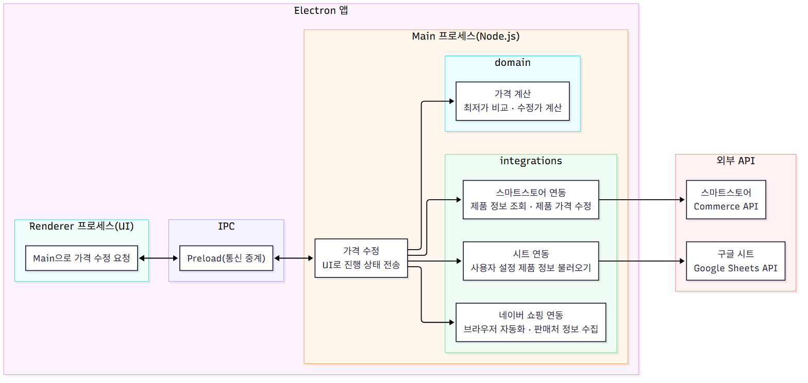

# 스마트스토어 최저가 자동 수정 프로그램 개선: CLI에서 Electron GUI로

네이버 스마트스토어 판매가를 경쟁 판매처보다 낮게 자동으로 유지해주는 CLI 프로그램을 TypeScript 마이그레이션, Vitest 테스트 코드 추가, Electron GUI 전환으로 개선하는 프로젝트입니다.

> 🚧 현재 진행 중입니다.

<!-- TODO: 앱 스크린샷 또는 GIF 추가 -->

## 기존 프로젝트(과거)

스마트스토어를 직접 운영하면서 매일 반복하던 가격 수정 작업을 자동화하기 위해 만든 CLI 프로그램입니다.

- **문제** — 경쟁 판매처 가격이 수시로 바뀌어, 제품마다 최저가를 확인하고 직접 수정하는 데 1개당 약 40초가 걸렸습니다.
- **해결** — Puppeteer로 판매처 가격을 수집하고, 목표가를 계산해 Commerce API로 자동 수정하는 CLI 프로그램을 만들었습니다.
- **성과** — 1개당 수정 시간을 약 15초로 줄였고, 3년 넘게 실제 운영에 사용하고 있습니다.

## 개선 프로젝트(현재)

직접 사용하면서 느낀 실행과 로그 확인의 불편함을 줄이기 위해, 사용 경험(UX)을 개선하고 있습니다.

- **문제** — 매번 CLI 명령어로 실행해야 했고, CMD 창에 쌓이는 로그로는 어떤 상품이 처리됐는지 한눈에 보기 어려웠습니다.
- **해결** — Electron GUI로 전환해 버튼 클릭으로 실행하고, 상품별 진행 상태를 화면에서 바로 확인할 수 있게 개선하고 있습니다.
- **성과** — 테스트 파일 40개로 주요 로직을 검증하고, 타입 검사로 IPC 계약을 컴파일 타임에 확인할 수 있게 됐습니다.

## 프로젝트 정보

| 항목      | 내용                                                                   |
| --------- | ---------------------------------------------------------------------- |
| 개발 형태 | 1인 개발                                                               |
| 운영 이력 | 3년 넘게 실제 스마트스토어 운영에 사용 중                              |
| 기간      | 2026년 7월 ~ 진행 중 (기존 운영 중이던 CLI 프로그램의 개선 작업)       |
| 역할      | 테스트 코드 작성, TypeScript 마이그레이션, Electron + React로 GUI 제공 |

## 프로젝트 배경

처음에는 `node app.js`로 실행하는 단일 CLI 스크립트였습니다. 실제 운영하며 느낀 불편함을 개선하는 과정을 아래 단계로 진행했습니다.

| 단계                       | 목표                                                                                   | 상태       |
| -------------------------- | -------------------------------------------------------------------------------------- | ---------- |
| 1. 로직 분리               | 한 파일에 섞여 있던 가격 계산·상품 매칭 로직을 순수 함수로 추출                        | ✅         |
| 2. 테스트                  | 추출한 도메인 로직과 외부 연동 모듈에 대한 단위 테스트 작성                            | ✅         |
| 3. TypeScript 마이그레이션 | 전체 코드 타입 안전성 확보                                                             | ✅         |
| 4. Electron + React UI     | 터미널 실행, 로그 대신 진행 상황을 확인할 수 있는 UI 제공 및 버튼 클릭으로 실행 간편화 | 🔄 진행 중 |

## 아키텍처

## 기술 스택

| 영역            | 사용 기술                                                                      |
| --------------- | ------------------------------------------------------------------------------ |
| 언어            | TypeScript                                                                     |
| 실행 환경       | Node.js                                                                        |
| 데스크톱        | Electron, electron-vite                                                        |
| UI              | React 19, styled-components                                                    |
| 브라우저 자동화 | Puppeteer                                                                      |
| 외부 API        | 네이버 커머스 API (OAuth 토큰 발급 · 상품 조회 · 가격 수정), Google Sheets API |
| 테스트          | Vitest, vitest-browser-react (Playwright 브라우저 모드)                        |
| 코드 품질       | ESLint, Prettier, Stylelint                                                    |
