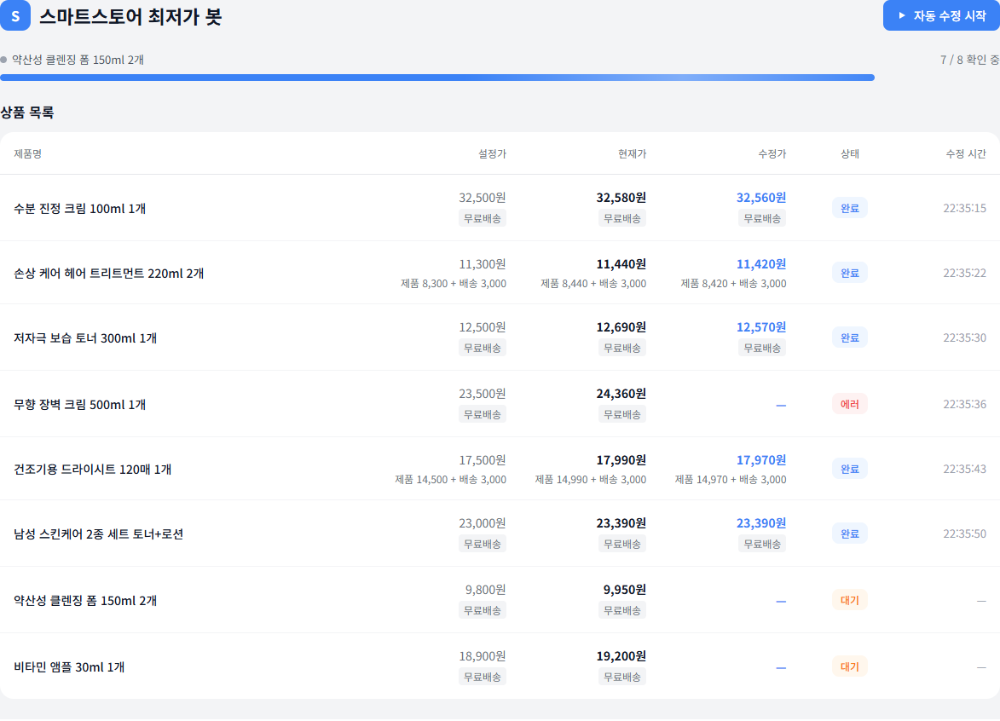
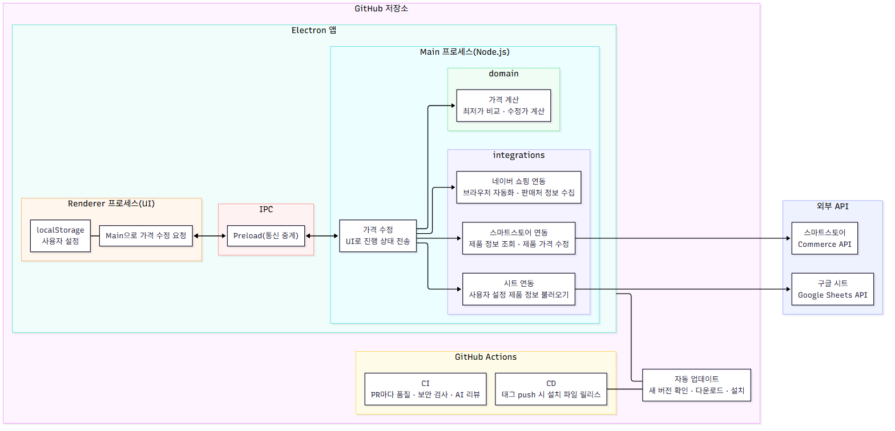

# 스마트스토어 최저가 자동 수정 프로그램 개선

1인 개발 · 작업 기간(2026년 7월 ~ 10월)

네이버 스마트스토어 판매가를 경쟁 판매처보다 낮게 자동으로 유지해주는 CLI 프로그램을 TypeScript 마이그레이션, Vitest 테스트 코드 추가, Electron GUI 전환으로 개선하는 프로젝트입니다.



## 기술 스택

| 영역            | 사용 기술                                                 |
| --------------- | --------------------------------------------------------- |
| 언어            | TypeScript                                                |
| 데스크톱        | Electron, electron-vite                                   |
| UI              | React 19, styled-components                               |
| 브라우저 자동화 | Puppeteer                                                 |
| 외부 API        | 스마트스토어 Commerce API, Google Sheets API              |
| 테스트          | Vitest, vitest-browser-react                              |
| 코드 품질       | ESLint, Prettier, Stylelint                               |
| CI/CD           | GitHub Actions                                            |
| 보안 검사       | Snyk, CodeQL, gitleaks, dependency-review                 |
| 패키징·업데이트 | electron-builder(NSIS), electron-updater, GitHub Releases |
| 의존성 관리     | Dependabot                                                |
| AI              | Claude Code, Claude Design                                |

## AI 활용

Claude Code와 Claude Design을 개발 과정 전반에 활용했습니다. AI가 만든 결과는 모두 직접 검토하고, 모르는 부분은 설명 주석·예시 시나리오·공식 문서를 요청해 확인한 뒤 반영합니다. 의도와 다르게 반복되는 결과는 `CLAUDE.md`와 스킬(`.claude/skills`)에 규칙으로 등록해 개선합니다.

- **보안 점검** — 취약점 탐색과 조치
- **테스트 작성** — 기능 코드와 테스트를 함께 수정, 실행은 직접
- **UI 디자인** — 토스증권 UI를 참고한 화면 제작
- **PR 리뷰** — PR마다 자동 AI 리뷰
- **형상 관리** — 커밋·브랜치·PR·이슈 관리, 검사를 통과한 PR만 병합
- **기능 구현** — 단계별 구현 계획을 받아 검토한 뒤, 한 단계씩 구현을 맡겨 확인

## 기존 프로젝트(과거)

스마트스토어를 직접 운영하면서 매일 반복하던 가격 수정 작업을 자동화하기 위해 만든 CLI 프로그램입니다.

- **문제** — 경쟁 판매처 가격이 수시로 바뀌어, 제품마다 최저가를 확인하고 직접 수정하는 데 1개당 약 40초가 걸렸습니다.
- **해결** — Puppeteer로 판매처 가격을 수집하고, 목표가를 계산해 Commerce API로 자동 수정하는 CLI 프로그램을 만들었습니다.
- **성과** — 1개당 수정 시간을 약 15초로 줄였고, 3년 넘게 실제 운영에 사용하고 있습니다.

## 개선 프로젝트(현재)

직접 사용하면서 느낀 불편한 점과 코드 구조를 함께 개선하고 있습니다.

### 보안 점검

#### 보안 점검 없이 써 온 앱, 안전한가?

- **문제** — 최근 보안 관련 문제가 자주 보였고, 이 앱도 네이버 계정과 Commerce API 키, Google 서비스 계정 키를 다루고 있어 취약점이 없는지 확인할 필요가 있었습니다.
- **해결** — 최근 읽은 『프런트엔드 개발자를 위한 보안 바이블』에서 학습한 내용을 바탕으로, 대상별로 보안 점검 목록을 작성해 Claude Code로 탐색했습니다.
  1. XSS와 localStorage
  2. CSP와 CSRF
  3. npm과 Node
  4. 에러 메시지와 하드코딩된 정보
  5. Electron 공식 보안 체크리스트(20개 항목)
  6. React
  7. GitHub와 Actions
  8. TypeScript와 JavaScript
  9. 추가 주제(Puppeteer, 외부 입력 검증, 앱 데이터 삭제)

  조치는 항목별로 브랜치와 PR을 나눠 병합했습니다. PR마다 워크플로로 dependency-review(의존성 취약점), CodeQL(코드 분석), gitleaks(비밀값 노출), AI 리뷰를 돌려 추가로 점검했고, Dependabot으로 기본 브랜치 의존성의 취약점을 감시합니다.

- **성과** — 보안 점검 항목 21건을 조치하고, 우선순위가 낮은 5건은 이슈로 분리했습니다.

  | 단계                             | 건수 | 조치 내용                                                                                                                                                                                                 |
  | -------------------------------- | ---- | --------------------------------------------------------------------------------------------------------------------------------------------------------------------------------------------------------- |
  | 1. XSS와 localStorage            | 0    | 조치할 항목 없음                                                                                                                                                                                          |
  | 2. CSP와 CSRF                    | 1    | CSP에 `object-src`, `base-uri`, `form-action` 추가                                                                                                                                                        |
  | 3. npm과 Node                    | 1    | Node·Electron 패치 버전으로 업데이트                                                                                                                                                                      |
  | 4. 에러 메시지와 하드코딩된 정보 | 1    | 로컬 실행 스크립트(`*.run.ts`)를 저장소에서 제외                                                                                                                                                          |
  | 5. Electron 공식 보안 체크리스트 | 7    | • preload의 `window.electron` 노출 제거<br>• IPC 발신자 검증<br>• 페이지 이동 차단<br>• 외부 링크 https만 허용<br>• 권한 요청 거부<br>• Fuses 설정<br>• `app://` 커스텀 프로토콜 적용                     |
  | 6. React                         | 1    | ESLint에 `react/no-danger`, `jsx-no-script-url` 규칙 추가                                                                                                                                                 |
  | 7. GitHub와 Actions              | 7    | • checkout `persist-credentials: false`<br>• 릴리스 태그가 기본 브랜치 커밋인지 검사<br>• 태그 보호 ruleset<br>• 보안 업데이트 켜기<br>• 악성 패키지 알림 켜기<br>• 비공개 취약점 제보 켜기<br>• 2FA 정리 |
  | 8. TypeScript와 JavaScript       | 0    | 우선순위가 낮은 4건을 이슈로 분리                                                                                                                                                                         |
  | 9. 추가 주제                     | 3    | • 카탈로그 URL 검증<br>• Puppeteer를 pipe로 실행해 디버깅 포트 닫기<br>• 앱 삭제 시 앱 데이터 삭제<br>(토큰 재사용 1건은 이슈로 분리)                                                                     |

#### Node.js에서 발견된 보안 취약점

- **문제** — Node.js Brotli 압축 해제 취약점(CVE-2026-111497)으로 로컬 Node(v24.14.0)와 Electron 내장 Node(v24.21.0)가 모두 영향을 받았습니다.
- **해결** — 로컬 Node는 패치 버전(v24.22.1)으로 올렸습니다. Electron은 안정 버전에 아직 패치가 없어, 우회 코드를 넣기 전에 두 외부 API가 실제로 Brotli로 응답하는지 측정했습니다.
  - `Accept-Encoding`을 `gzip`/`br`로 바꿔 10회씩 호출한 결과, Google Sheets API는 무압축(297B) 또는 gzip(226B), Commerce API는 무압축(242,821B)으로만 응답했습니다.
  - 요청 헤더로 Brotli를 막는 방법은 googleapis가 헤더를 `gzip`으로 덮어써 효과가 없다는 것도 확인했습니다.
- **성과** — 두 API 모두 Brotli 응답이 없어, 코드 수정 없이 Electron 패치 버전이 나오면 업데이트하는 것으로 대응을 정리했습니다.

### 사용자 경험

#### 매번 CLI로 실행해야 하는 불편함

- **문제** — 실행할 때마다 CMD 실행 → 프로젝트 폴더로 이동 → 명령어 입력을 거쳐야 했습니다.
- **해결** — Electron GUI로 전환해 버튼 클릭으로 실행할 수 있게 했습니다.
- **이유** — `.bat` 파일로도 실행 과정은 줄일 수 있지만, 실행 상황 표시처럼 이후 추가할 기능을 고려해 GUI를 선택했습니다.
- **성과** — 실행 과정을 3단계(CMD 실행 → 폴더 이동 → 명령어 입력)에서 2단계(프로그램 실행 → 시작 버튼 클릭)로 줄였습니다.

#### 실패해도 이유를 화면에서 알 수 없는 문제

- **문제** — 가격 수정에 실패하면 "에러" 뱃지만 떠서 이유를 알 수 없었고, 잘못된 시트 행은 조용히 건너뛰거나 가격 수정 전체를 멈췄습니다.
- **해결** — 에러 메시지를 한 파일에 모아 이해하기 쉬운 말로 다듬고, 실패해도 멈추지 않고 결과로 돌려주게 했습니다. 실패 이유는 상태 칸과 Header 아래 배너로 표시했습니다. ([트러블슈팅 참고](#에러-구조와-사용자-경험-개선하기))
- **성과** — 콘솔 로그를 열지 않고도 화면에서 실패한 제품과 이유를 바로 확인할 수 있게 됐습니다.

#### 새 버전을 매번 직접 설치해야 하는 번거로움

- **문제** — 프로그램을 돌리는 원격 PC에 새 버전을 반영하려면, 매번 Releases에서 설치 파일을 내려받아 다시 설치해야 했습니다.
- **해결** — electron-updater로 앱이 켜질 때 GitHub Releases의 새 버전을 확인해 백그라운드에서 내려받게 했습니다. 다운로드가 끝나면 알림을 띄우고, 앱을 종료할 때 설치 창을 띄워 진행 상황을 볼 수 있게 했습니다. 다운로드에 실패하면 실패 알림을 띄웁니다.
- **이유** — Electron 내장 `autoUpdater`는 Windows에서 Squirrel·MSIX 설치 방식만 지원해, 이 프로젝트가 쓰는 NSIS 설치 파일을 지원하는 electron-updater를 선택했습니다.
- **성과**
  - Release를 공개하면 원격 PC에서는 앱을 켰다 끄는 것만으로 새 버전이 설치되게 됐습니다.
  - draft Release는 업데이트 대상이 아니어서, 설치를 테스트한 버전만 자동 업데이트로 배포됩니다.

#### 재부팅되면 가격 수정이 멈추는 문제

- **문제** — 원격 PC가 원인 모를 이유(메모리 문제로 추정)로 하루에 1번꼴로 재부팅됐고, 그때마다 프로그램이 꺼져 다시 실행하기까지 약 3시간 동안 가격 수정이 멈췄습니다.
- **해결** — Windows 시작 프로그램에 등록해 재부팅 후 앱이 자동으로 켜지게 하고, 시작 프로그램으로 켜졌을 때는 설정한 대기 시간(기본 5분)이 지나면 가격 수정을 자동으로 시작하게 했습니다. 대기 중에는 남은 시간을 화면에 보여주고, 시작 버튼을 누르면 자동 시작을 취소하고 바로 시작합니다. 사람이 직접 켰을 때는 자동으로 시작하지 않습니다.
- **성과** — 재부팅돼도 사람이 원격으로 접속해 다시 실행하지 않아도 가격 수정이 이어지게 됐습니다.

### 개발자 경험

#### GUI 전환 중 기존 기능이 깨질 수 있다는 걱정

- **문제** — CLI 코드를 Electron GUI로 옮기는 과정에서 기존 기능이 그대로 동작할지 확신할 수 없었습니다.
- **해결** — TypeScript로 마이그레이션해 타입 안전성을 확보하고, Vitest로 기존 기능의 테스트 코드를 작성했습니다.
- **이유** — JSDoc은 타입을 주석으로 따로 적어야 해서, 언어 차원에서 타입을 한 번에 다룰 수 있는 TypeScript를 선택했습니다. 테스트 도구는 실행 속도가 빠른 Vitest를 선택했습니다.
- **성과** — 테스트 케이스 약 300개로 주요 로직을 검증하고, 정적 타입 검사로 에러를 미리 발견할 수 있게 됐습니다.

#### React 훅이 순회까지 맡아 복잡해진 구조

- **문제** — React 훅이 제품을 순회하며 제품마다 main에 4번씩 요청해, 훅이 화면 상태 관리를 넘어 순회 제어까지 맡고 있었습니다.
- **해결** — 순회를 main으로 옮기고, React는 시작 요청과 상태 수신만 하게 했습니다. ([트러블슈팅 참고](#가격-수정-순회를-react에서-main으로-옮기기))
- **이유** — 바뀐 상태만 보내는 방식보다 React 쪽 처리가 단순한, 상태 전체를 보내는 방식을 골랐습니다. 목록 전체를 보내는 부담은 제품마다 10초씩 대기하는 순회에 비하면 작다고 판단했습니다.
- **성과** — 훅 코드는 약 120줄에서 60줄로, 훅 테스트는 약 470줄에서 160줄로 줄었고, 제품 1개당 React → main 요청이 4번에서 0번이 됐습니다.

#### 검사와 배포를 매번 직접 해야 하는 번거로움

- **문제** — 1인 개발이라 코드를 봐 줄 리뷰어가 없고, 테스트·린트 같은 검사를 직접 돌리다 빠뜨릴 수 있었습니다. 앱을 배포하려면 직접 빌드해 설치 파일을 만들어야 했습니다.
- **해결** — GitHub Actions로 PR마다 품질 검사(린트·타입·테스트·빌드), 보안 검사(CodeQL·gitleaks·의존성 리뷰), AI 코드 리뷰가 자동으로 돌게 했습니다. 버전 태그를 push하면 Windows 설치 파일을 빌드해 GitHub Releases에 draft로 올리고, 설치를 실제로 테스트한 뒤 공개합니다.
- **성과**
  - 품질 검사를 통과해야 병합할 수 있게 해 검사를 빠뜨리지 않게 됐습니다.
  - 태그 push 한 번으로 설치 파일 배포까지 끝나게 됐습니다.
  - Dependabot이 찾은 패키지 취약점 41건 중 39건(critical 1건, high 14건 포함)을 쓰지 않는 의존성 8개 삭제와 취약한 의존성 업데이트로 해결했습니다.
  - Dependabot이 매주 올리는 업데이트 PR을 품질 검사로 확인한 뒤 병합해, 패키지 15개를 최신 버전으로 유지했습니다.

#### PR 검사에서 Electron 바이너리를 생략하려던 시도

- **문제** — PR 품질 검사(PR Gate)에서 가장 오래 걸리는 단계는 `npm ci`(중앙값 41.5초)였습니다. `npm ci`가 매번 Electron 바이너리(약 118MB)를 내려받는다고 보고, 이를 생략하면 시간을 줄일 수 있다고 판단했습니다.
- **과정** — 검사 job에 `ELECTRON_SKIP_BINARY_DOWNLOAD`를 설정했습니다. 테스트는 Electron을 mock으로 대체하고 빌드는 npm 패키지만 쓰므로 바이너리가 없어도 된다고 봤습니다. 과거 실행 기록은 시간대와 러너 상태가 제각각이라, 같은 검사를 러너 10대에서 동시에 돌리는 측정용 설정을 만들어 변경 전후를 10회씩 비교했습니다.
- **결과** — 테스트와 빌드는 모두 통과했지만 `npm ci` 시간은 줄지 않았습니다. 처음에는 러너 상태 차이 때문에 효과가 묻혔다고 생각했지만, 성과로 기록하기 전에 실제로 다운로드가 생략됐는지 워크플로 로그로 확인하기로 했습니다. Claude Code와 함께 Electron 패키지 코드를 확인해 보니, 현재 버전(Electron 44)은 설치할 때가 아니라 처음 실행할 때 바이너리를 내려받도록 바뀌어 있었습니다. 변경 전후 로그 모두에 다운로드 기록(`Downloading Electron binary...`)이 없어, CI에서는 원래 바이너리를 내려받지 않고 있었다는 것을 확인했습니다.

  | 단계   | 변경 전 중앙값 (범위) | 변경 후 중앙값 (범위) |
  | ------ | --------------------- | --------------------- |
  | npm ci | 41.5초 (37~60초)      | 59초 (39~64초)        |

  | 회차 | 변경 전 npm ci | 변경 후 npm ci |
  | ---- | -------------- | -------------- |
  | 1    | 60초           | 61초           |
  | 2    | 42초           | 58초           |
  | 3    | 41초           | 61초           |
  | 4    | 39초           | 50초           |
  | 5    | 59초           | 60초           |
  | 6    | 37초           | 64초           |
  | 7    | 41초           | 56초           |
  | 8    | 49초           | 47초           |
  | 9    | 57초           | 39초           |
  | 10   | 41초           | 61초           |

  변경 후가 오히려 느린 것은 이 설정과 무관한 타입 검사(8.5초 → 12초)와 빌드(21.5초 → 29초)도 함께 느려진 것으로 보아 러너 상태 차이입니다.

- **성과** — 적용 전에 측정해서 효과 없는 설정이 워크플로에 남지 않게 했습니다. 이때 만든 변경 전 기준 수치와 측정 방식은 다음 개선안에도 그대로 씁니다.

#### PR 검사의 브라우저 설치가 가끔 수 분씩 걸리는 문제

- **문제** — PR 품질 검사에서 테스트용 브라우저를 설치하는 단계(`npx playwright install --with-deps chromium`)가 보통 17초였지만, 20회 중 4회는 30초를 넘었고 가장 길 때는 408초가 걸렸습니다. 저장소 서버 장애로 이 단계에서 10분을 쓰고 실패한 적도 있었습니다.
- **과정** — 로그에서 설치 단계의 시간을 나눠 보니, 브라우저 다운로드는 5~9초로 안정적이었고 시간이 튀는 구간은 매번 `--with-deps`가 실행하는 Ubuntu 패키지(apt) 설치였습니다. 그런데 apt가 실제로 새로 설치하는 것은 폰트 9개뿐이었고, 브라우저 실행에 필요한 라이브러리는 GitHub 러너에 이미 들어 있었습니다. 그래서 `--with-deps`를 빼고 브라우저만 내려받게 바꿨습니다. 브라우저와 의존성이 모두 들어 있는 Playwright 공식 Docker 이미지도 같은 방식으로 측정해 비교했습니다.
- **결과** — `--with-deps`를 뺀 방식이 가장 빠르고 안정적이었습니다. Docker 이미지는 apt 설치는 없지만 약 1GB인 이미지를 매번 내려받아 더 느렸습니다. 폰트 없이도 테스트 631개가 20회 모두 통과했습니다.

  | 방법 (각 20회)           | 브라우저 준비 중앙값 | 범위     | 30초 초과 |
  | ------------------------ | -------------------- | -------- | --------- |
  | 기존 (`--with-deps`)     | 17초                 | 13~408초 | 4회       |
  | `--with-deps` 제거       | 9초                  | 5~10초   | 0회       |
  | Playwright Docker 이미지 | 21초 (이미지 pull)   | 18~31초  | 1회       |

  | 회차 | 기존 (`--with-deps`) | `--with-deps` 제거 | Docker 이미지 pull |
  | ---- | -------------------- | ------------------ | ------------------ |
  | 1    | 17초                 | 9초                | 31초               |
  | 2    | 57초                 | 7초                | 20초               |
  | 3    | 39초                 | 9초                | 22초               |
  | 4    | 14초                 | 10초               | 27초               |
  | 5    | 408초                | 9초                | 18초               |
  | 6    | 13초                 | 8초                | 22초               |
  | 7    | 52초                 | 7초                | 21초               |
  | 8    | 24초                 | 8초                | 20초               |
  | 9    | 17초                 | 9초                | 28초               |
  | 10   | 15초                 | 8초                | 20초               |
  | 11   | 17초                 | 9초                | 26초               |
  | 12   | 16초                 | 7초                | 21초               |
  | 13   | 18초                 | 7초                | 21초               |
  | 14   | 17초                 | 5초                | 27초               |
  | 15   | 22초                 | 9초                | 20초               |
  | 16   | 22초                 | 9초                | 21초               |
  | 17   | 16초                 | 10초               | 20초               |
  | 18   | 16초                 | 9초                | 21초               |
  | 19   | 14초                 | 9초                | 21초               |
  | 20   | 18초                 | 8초                | 26초               |

- **성과** — 브라우저 준비 시간을 중앙값 17초에서 9초로 줄이고, 최악의 경우를 408초에서 10초로 줄였습니다. 저장소 서버 장애에 영향받던 apt 설치 단계를 없애 검사가 외부 장애로 실패할 일도 줄었습니다.

#### PR 검사마다 의존성을 처음부터 설치하는 문제

- **문제** — PR 품질 검사에서 가장 오래 걸리는 단계는 의존성 설치(`npm ci`, 중앙값 59.5초)였습니다. 패키지 압축 파일 캐시(`~/.npm`)를 쓰고 있었지만, 새 PR의 첫 실행에서는 한 번도 캐시를 찾지 못했습니다(`npm cache is not found`).
- **과정** — 캐시 목록을 확인해 보니 캐시가 모두 각 PR 범위(`refs/pull/번호/merge`)에만 저장돼 있었습니다. GitHub Actions에서 PR이 저장한 캐시는 그 PR만 쓸 수 있어, 다른 PR은 읽지 못합니다. 또 압축 파일 캐시는 캐시를 찾더라도 `node_modules`를 다시 만들어야 해 설치 시간이 크게 줄지 않았습니다.
  - `node_modules`를 통째로 캐시하고, `package-lock.json` 해시가 정확히 같을 때만 복원해 `npm ci`를 건너뛰게 했습니다.
  - PR이 머지돼 base 브랜치에 push될 때도 검사를 실행해, 모든 PR이 읽을 수 있는 base 브랜치 범위에 캐시를 저장하게 했습니다.
  - 두 캐시가 모두 lock 파일 해시로 만들어져 항상 같이 찾거나 같이 못 찾으므로, 쓰이지 않게 된 압축 파일 캐시는 제거했습니다.
- **결과** — 같은 PR에서 캐시가 없는 첫 실행과 캐시가 있는 재실행을 3분 간격으로 10회씩 측정했습니다. 캐시가 있으면 `npm ci`를 건너뛰고 약 85MB를 3초 만에 복원해, 검사 전체가 133.5초에서 73초로 줄었습니다. 머지 후 base 브랜치 실행에서 캐시가 저장된 것(`Cache saved with key: node-modules-Linux-...`)도 확인했습니다.

  | 조건 (각 10회)       | 의존성 준비 중앙값 | 검사 전체 중앙값 | 검사 전체 범위 |
  | -------------------- | ------------------ | ---------------- | -------------- |
  | 캐시 없음 (`npm ci`) | 59.5초             | 133.5초          | 105~145초      |
  | 캐시 있음 (복원)     | 3초                | 73초             | 57~80초        |

  | 회차 | 캐시 없음 `npm ci` | 캐시 없음 전체 | 캐시 있음 복원 | 캐시 있음 전체 |
  | ---- | ------------------ | -------------- | -------------- | -------------- |
  | 1    | 49초               | 112초          | 3초            | 64초           |
  | 2    | 63초               | 145초          | 2초            | 66초           |
  | 3    | 62초               | 139초          | 2초            | 57초           |
  | 4    | 42초               | 105초          | 5초            | 80초           |
  | 5    | 61초               | 135초          | 4초            | 71초           |
  | 6    | 59초               | 135초          | 3초            | 61초           |
  | 7    | 42초               | 108초          | 4초            | 78초           |
  | 8    | 41초               | 105초          | 3초            | 78초           |
  | 9    | 60초               | 136초          | 3초            | 77초           |
  | 10   | 60초               | 132초          | 4초            | 75초           |

- **성과** — 의존성을 바꾸지 않은 PR은 첫 실행부터 검사 시간이 약 45% 줄어들게 됐습니다. 의존성을 바꾼 PR은 이전과 같은 시간이 걸리고, 머지되면 새 캐시가 저장됩니다.

#### 빌드할 때마다 30초씩 기다려야 하는 문제

- **문제** — 앱을 빌드하면(`npm run build:electron`) main 프로세스 빌드에만 약 30초가 걸렸습니다. 개발 모드(`npm run dev`)도 화면이 뜨기까지 약 40초를 기다려야 했고, PR 품질 검사에서도 빌드가 가장 긴 단계(30초)였습니다. 빌드 결과물 `out/main/index.cjs`는 30.8MB나 됐습니다.
- **과정** — 소스맵과 `source-map-explorer`로 번들 구성을 확인해 보니, 30.8MB 중 93.8%(28.9MB)가 `googleapis` 패키지였습니다. 안에는 Google API 327개가 들어 있었지만, 실제로 쓰는 Sheets API는 21KB뿐이었습니다.
  - `googleapis`는 진입점에서 모든 API를 `require`해 한 객체에 모으고, 생성할 때 그 객체를 전부 순회하는 CommonJS 구조라 번들러가 쓰지 않는 API를 걸러내지(트리 쉐이킹) 못했습니다.
  - 출력 형식을 ESM으로 바꾸는 방법도 검토했지만, 문제는 입력 패키지의 구조라 효과가 없다고 판단했습니다.
  - `googleapis` 공식 README가 시작 시간을 줄이는 방법으로 안내하는 Sheets 전용 서브모듈(`@googleapis/sheets`)로 바꿨습니다.
- **결과** — 쓰지 않던 API 326개가 빠지면서 main 빌드가 약 90% 줄었습니다. 같은 PC에서 교체 전후 11회씩 측정했습니다.

  | 항목                             | 교체 전      | 교체 후   |
  | -------------------------------- | ------------ | --------- |
  | main 빌드 (11회 중앙값)          | 29.60초      | 2.79초    |
  | 빌드 결과물 `out/main/index.cjs` | 30,824,078 B | 993,091 B |
  | 설치된 앱 코드 `app.asar`        | 65.7MiB      | 37.3MiB   |
  | PR 검사의 빌드 단계              | 30초         | 2초       |
  | PR 검사의 타입 검사 단계         | 11~12초      | 4~6초     |
  | 앱 창이 뜨는 시간 (11회 중앙값)  | 1,359ms      | 1,033ms   |

  | 회차 | 교체 전 main 빌드 | 교체 후 main 빌드 | 교체 전 창 표시 | 교체 후 창 표시 |
  | ---- | ----------------- | ----------------- | --------------- | --------------- |
  | 1    | 29.60초           | 2.64초            | 1,369ms         | 1,169ms         |
  | 2    | 29.46초           | 2.80초            | 1,355ms         | 1,004ms         |
  | 3    | 31.02초           | 3.29초            | 1,353ms         | 1,003ms         |
  | 4    | 29.98초           | 2.90초            | 1,304ms         | 1,082ms         |
  | 5    | 29.08초           | 2.55초            | 1,408ms         | 1,033ms         |
  | 6    | 28.77초           | 2.81초            | 1,359ms         | 1,086ms         |
  | 7    | 29.42초           | 2.84초            | 1,338ms         | 994ms           |
  | 8    | 30.70초           | 2.79초            | 1,458ms         | 1,047ms         |
  | 9    | 31.35초           | 2.76초            | 1,442ms         | 1,033ms         |
  | 10   | 29.11초           | 2.65초            | 1,437ms         | 1,011ms         |
  | 11   | 29.73초           | 2.62초            | 1,356ms         | 1,184ms         |

  앱 창이 뜨는 시간은 교체 전후 버전을 각각 패키징해, 실행 파일을 띄운 시점부터 창이 만들어질 때까지를 PowerShell로 쟀습니다. main 프로세스가 창을 만들기 전에 번들을 불러오는데, 불러올 코드가 30.8MB에서 1.0MB로 줄면서 창이 0.33초(24%) 빨리 뜹니다. 교체 후 가장 느린 값(1,184ms)도 교체 전 가장 빠른 값(1,304ms)보다 빨랐습니다.

  타입 검사 단계도 함께 줄었는데, `googleapis`의 타입 선언(API 327개 분량)을 더 이상 검사하지 않기 때문으로 보입니다. 설치 파일(`setup.exe`)은 압축돼 있어 125.3MB에서 124.8MB로 0.4%만 줄었습니다.

- **성과** — 빌드 대기 시간이 30초에서 3초 안팎으로 줄어 개발 모드 실행과 PR 품질 검사가 함께 빨라졌습니다. 앱 창이 뜨는 시간이 24% 줄고, 설치된 앱 코드도 43% 가벼워졌습니다.

#### 앱이 켜질 때 쓰지 않는 HTML 파서까지 불러오는 문제

- **문제** — 판매처 정보를 읽는 데 HTML 파서 `jsdom`을 쓰고 있었는데, 빌드 결과물 맨 위에서 `require("jsdom")`이 실행돼 앱 창이 뜨기 전에 항상 불러왔습니다. `jsdom`은 실제로 가격 수정을 시작한 뒤에만 쓰입니다. 또 `jsdom` 때문에만 설치되는 패키지가 58개로, 설치된 앱 코드(`app.asar`)의 26.7%(9.7MiB)를 차지했습니다.
- **과정** — 판매처 정보를 가져오는 흐름을 보니, 브라우저(Puppeteer)에 이미 그려진 판매처 요소를 HTML 문자열(`outerHTML`)로 꺼낸 뒤 Node에서 `jsdom`으로 다시 DOM을 만들어 읽고 있었습니다.
  - 브라우저 안에서 판매처명·가격·할인가·배송비 텍스트만 꺼내 오도록(`page.evaluate`) 바꾸고, Node에서는 텍스트를 숫자와 배송비 유형으로 변환만 하게 했습니다.
  - 실제 네이버 페이지를 캡처한 HTML로 판매처 10곳을 검증하던 테스트는 그대로 유지했습니다. 이 테스트에서만 `jsdom` 환경을 쓰도록 바꾸고, `jsdom`은 개발 의존성(`devDependencies`)으로 옮겨 설치 파일에서 뺐습니다.
- **결과** — 패키징한 앱을 실행해 창이 만들어질 때까지를 11회씩 쟀습니다.

  | 항목                       | 제거 전                | 제거 후                |
  | -------------------------- | ---------------------- | ---------------------- |
  | 앱 창이 뜨는 시간 (중앙값) | 1,033ms (994~1,184ms)  | 790ms (739~858ms)      |
  | 설치된 앱 코드 `app.asar`  | 39,083,063 B (37.3MiB) | 28,622,053 B (27.3MiB) |

  | 회차 | 제거 전 창 표시 | 제거 후 창 표시 |
  | ---- | --------------- | --------------- |
  | 1    | 1,169ms         | 820ms           |
  | 2    | 1,004ms         | 790ms           |
  | 3    | 1,003ms         | 744ms           |
  | 4    | 1,082ms         | 858ms           |
  | 5    | 1,033ms         | 806ms           |
  | 6    | 1,086ms         | 791ms           |
  | 7    | 994ms           | 745ms           |
  | 8    | 1,047ms         | 771ms           |
  | 9    | 1,033ms         | 783ms           |
  | 10   | 1,011ms         | 841ms           |
  | 11   | 1,184ms         | 739ms           |

  Node에서 `require("jsdom")`만 따로 쟀을 때는 약 0.66초였지만, 실제 앱에서 줄어든 시간은 약 0.24초였습니다. 그래서 성과는 실제 앱에서 잰 값으로 기록했습니다.

- **성과** — 앱 창이 뜨는 시간이 24% 줄고, 설치된 앱 코드가 27% 가벼워졌습니다. 앞의 `googleapis` 교체와 합치면 창이 뜨는 시간은 1,359ms에서 790ms로 42% 줄었습니다.

## 아키텍처



## 트러블슈팅

### 가격 수정 순회를 React에서 main으로 옮기기

**S — 상황**

가격 수정을 시작하면, React 훅(`useTargetProductsUpdate`)이 아래처럼 제품을 순회하며 단계마다 main에 요청을 보냈습니다. 처음에 이 구조를 택한 건 통신이 단순해서였습니다. 작은 기능을 하나씩 실행해 확인할 수 있었고, 요청마다 응답이 바로 돌아왔습니다.

```ts
// 변경 전: React 훅이 제품마다 main에 4번 요청
const useTargetProductsUpdate = () => {
  const start = async () => {
    for (const targetProduct of targetProducts) {
      const sellers = await window.api.getSellers(catalogURL, name);
      if (!sellers.isSuccess) break;

      // 내 스토어 이름이 main에만 있어 필터링도 main에 요청
      const filtered = await window.api.filterSellers(sellers.sellers, excluded);
      if (!filtered.isSuccess) break;

      const targetPrice = await window.api.getTargetPrice(prices, freeDeliveryPrice);
      if (!targetPrice.isSuccess) break;

      const result = await window.api.updatePrice(
        originProductNo,
        targetPrice.targetPrice,
        delivery,
      );
      if (!result.isSuccess) break;

      // ... 중간 과정 생략

      // 수정 결과를 화면 상태에 반영
      setUpdatedProducts(updatedTargetProducts);
    }
  };
};
```

하지만 기능을 추가하면서 이 구조로 계속 진행해도 괜찮은지 의문이 들었습니다.

- **훅의 책임을 벗어난 순회**: 훅의 책임은 화면에 보여줄 상태를 관리하는 것인데, 제품 수정 제어와 순회까지 맡으면서 범위를 벗어났습니다.
  - 훅이 약 120줄, 테스트가 약 470줄로 길어지고 이해하기 어려워졌습니다.
  - 무엇을 main에 요청할지 기준이 없어, 순수 함수인 수정가 계산(`getTargetPrice`)까지 형식적으로 main에 요청했습니다.
- **반복되는 통신 패턴**: 제품마다 main에 요청하고 `if (!x.isSuccess) break;`로 응답을 확인하는 패턴이 4번씩 반복됐습니다.

**T — 과제**

위 두 가지를 해결하기 위해 아래를 목표로 잡았습니다.

- **역할 분리**: 제품 수정 제어와 순회, 계산까지 모두 main이 맡고, 훅은 화면에 보여줄 상태만 관리하게 합니다.
- **통신 단순화**: 제품마다 4번씩 반복되던 요청과 응답 확인을 없애, React는 시작 요청과 상태 수신만 하게 합니다.

**A — 행동**

| 선택지                                                | 한계                                                               |
| ----------------------------------------------------- | ------------------------------------------------------------------ |
| A. React 순회 유지, 4개 채널을 1개로 합치기           | 순회와 제품 수정 제어가 여전히 React에 남아, 역할 분리가 되지 않음 |
| **B. 순회를 main으로 옮기고 상태 전체를 전송 (선택)** | 제품 1개만 수정돼도 목록 전체(약 150개)를 다시 보냄                |
| C. 순회를 main으로 옮기고 바뀐 상태만 전송            | 바뀐 상태 종류마다 React에 처리 분기가 늘어 복잡해짐               |

두 목표를 만족하면서 React 쪽 처리가 가장 단순한 B를 선택했습니다. 목록 전체를 보내는 부담은 제품마다 10초씩 대기하는 순회에 비하면 작다고 판단했습니다.

```ts
// 변경 후: React 훅은 시작 요청 1번, 이후 main이 보내는 상태를 받기만 함
const useTargetProductsUpdate = () => {
  // main이 보내는 메시지를 수신하는 이벤트를 등록해 상태 업데이트
  useEffect(() => window.api.onUpdateState((state) => setUpdateState(state)), []);

  // main에 가격 수정 시작 요청
  const startUpdate = () => window.api.startUpdate();
};
```

**R — 결과**

| 항목                         | 변경 전         | 변경 후                                      |
| ---------------------------- | --------------- | -------------------------------------------- |
| 훅 코드                      | 약 120줄        | 약 60줄                                      |
| 훅 테스트                    | 약 470줄 · 22개 | 약 160줄 · 8개                               |
| 제품 1개당 React → main 요청 | 4번             | 0번                                          |
| React에 노출한 통신 채널     | 6개             | 2개(가격 수정 요청, 메시지 수신 이벤트 등록) |

- 순회가 main 한 곳에 모여, 중복 실행 방지 같은 제어를 main에서만 처리하면 됩니다.

### 제품 가격비교 페이지 접속 차단 해결하기

**S — 상황**

어느 날 아침 확인해 보니, 프로그램이 가격비교 도메인(`search.shopping.naver.com`)에 접속할 때 접속 차단 페이지를 받고 있었습니다.

- **계정 차단**: 다른 브라우저나 모바일 데이터로 접속해도 마찬가지여서, 계정 자체가 차단된 상태였습니다.
- **예외 처리 부재**: 차단 페이지를 받고도 프로그램이 멈추지 않고 계속 돌았습니다.
- **쌓인 잘못된 요청**: 제품 하나에 페이지 3개를 거치고 150개를 반복하는 구조라, 자는 동안 약 13,000회의 잘못된 요청이 반복됐습니다. 서버가 이 패턴을 감지해 계정을 차단한 것으로 보입니다.

**T — 과제**

- **사고 재발 방지**: 차단 페이지를 받으면 즉시 멈춰, 잘못된 요청이 쌓이지 않게 합니다.
- **사이클 복구**: 제품 150개를 한 바퀴 도는 사이클이 차단 없이 다시 돌게 합니다.

**A — 행동**

먼저 차단 페이지를 감지하면 예외를 던지고, 이 예외만은 다음 제품으로 넘어가지 않고 순회를 멈추게 했습니다.

```ts
if (await isRestrictedPage(page)) {
  throw new UnexpectedCatalogPageError('네이버 쇼핑 접속이 일시적으로 제한되었습니다.');
}
```

다른 계정으로 로그인해 실행하니 다시 동작했습니다. 하지만 차단 페이지가 떴다는 건 서버가 무언가를 감지했다는 뜻이라, 같은 방식으로는 다시 차단될 수 있었습니다. 그래서 먼저 로그인한 상태에서 차단 조건을 찾았습니다.

| 시도                                         | 가설                               | 결과                                                     |
| -------------------------------------------- | ---------------------------------- | -------------------------------------------------------- |
| 9번째 제품마다 브라우저 재실행               | 브라우저 단위로 요청이 집계된다    | 15번째쯤 다시 막힘 → 브라우저가 아니라 IP 기준으로 추정  |
| 페이지 이동마다 2~3초, 재실행 시 30초 딜레이 | 짧은 간격으로 요청 한도를 소진한다 | 정상 동작. 대신 사이클이 20분에서 40분으로 늘어남        |
| puppeteer-extra stealth 플러그인             | 봇으로 탐지된다                    | 변화 없음. IP 기준이라면 브라우저 흔적을 지워도 소용없음 |

딜레이를 넣은 설정으로 2주쯤 돌았지만 두 번째 계정도 차단됐습니다. 계정을 계속 구하기는 어려워, 로그인 없이 돌릴 수 있는지 시도했습니다.

| 시도                               | 가설                                    | 결과                                                 |
| ---------------------------------- | --------------------------------------- | ---------------------------------------------------- |
| 로그인 과정만 제거                 | 로그인 없이도 접근할 수 있다            | 9번째 제품에서 로그인 페이지로 리다이렉트            |
| 조회 간격 테스트(11초, 30초, 60초) | 간격을 늘리면 한도 안에서 돌 수 있다    | 11초·30초는 8회차에서 막힘. 60초는 17회 통과         |
| 잘못된 URL 정리                    | 특정 제품에서만 보안 확인 페이지가 뜬다 | 시트의 오래된 URL이 원인. 최신 URL로 바꾸자 해결     |
| 리다이렉트되면 30분 대기 후 재개   | 한도가 시간이 지나면 회복된다           | 회복 후에도 다시 막히는 등 불규칙해 사이클 완주 불가 |

테스트 중에 두 응답의 원인이 서로 다르다는 것을 확인했습니다.

- **보안 확인 페이지**: 오래되거나 잘못된 파라미터가 있는 URL로 접속할 때
- **로그인 페이지 리다이렉트**: 요청 한도를 다 썼을 때

한도에 대한 일관된 규칙은 알 수 없어, 실제로 판매 중인 비슷한 프로그램의 설정(로그인 필수, 제품 간 10초 대기)을 기준점으로 삼았습니다.

최종적으로는 로그인을 유지하고, 요청 횟수 자체를 줄였습니다. 경로에서 페이지를 하나씩 빼며 테스트해 보니, 처음에 가격비교 홈을 한 번만 방문하면 이후에는 제품 가격비교 페이지로 바로 이동할 수 있었습니다. 제품 사이 간격은 참고한 프로그램에 맞춰 10초로 늘렸습니다.

**R — 결과**

| 항목                            | 차단 당시 | 개선 후                     |
| ------------------------------- | --------- | --------------------------- |
| 제품당 요청                     | 3회       | 1회(첫 실행 시 홈 1회 제외) |
| 제품 간 이동 간격               | 5초       | 10초                        |
| 제품 1개당 수정 시간(대기 포함) | 약 9초    | 약 15초                     |
| 차단 페이지 응답 시             | 계속 실행 | 즉시 종료                   |

- 한 사이클(제품 150개)을 약 40분에 돌며, 2개월 넘게 차단 없이 운영하고 있습니다.
- 보안 확인 페이지(잘못된 URL)와 로그인 리다이렉트(요청 한도)의 원인을 구분해, 요청 횟수를 줄이는 방향으로 해결했습니다.

### 에러 구조와 사용자 경험 개선하기

**S — 상황**

**사용자 경험의 문제**

- **원인을 알 수 없는 에러**: 화면에 "에러" 뱃지만 있고 메시지가 없어, 사용자가 가격 수정 실패 원인을 알 수 없었습니다.
- **잘못된 시트 행 처리**: 가격 칸이 잘못되면 그 제품을 조용히 건너뛰고, 배송 유형이 잘못되면 가격 수정 전체가 멈췄습니다. 어느 쪽이든 어떤 제품의 어느 칸이 문제인지 알 수 없었습니다.
- **아무것도 뜨지 않는 시작 전 실패**: 시트 목록 조회나 네이버 로그인에서 실패하면 화면에 아무것도 표시되지 않았습니다.

**에러 구조의 문제**

- **흩어진 메시지**: 에러 메시지 25곳이 17개 파일에 문자열로 직접 적혀 있었습니다.
- **중복된 메시지**: 같은 문구가 여러 곳에 있었습니다. 예를 들어 `'알 수 없는 배송비 유형입니다.'`는 3곳에 있었습니다.
- **중단할 에러를 구분하기 어려운 구조**: 접속 차단처럼 다음 제품도 실패할 에러는 순회를 멈춰야 합니다. 하지만 이 에러(`UnexpectedCatalogPageError`)는 가장 바깥에 있을 때만 구분할 수 있어서, 어디서 던지든 거치는 중간 함수마다 감싸지 않고 그대로 다시 던져야 했습니다.

**T — 과제**

- **사용자 경험**: 잘못 입력된 시트 칸, 가격 수정에 실패한 제품, 순회 시작 전 실패의 이유를 화면에서 바로 확인할 수 있게 합니다.
- **시트 행 처리**: 잘못된 행 하나가 가격 수정 전체를 멈추지 않게 하고, 정상인 제품은 계속 처리합니다.
- **에러 구조**: 메시지를 한곳에서 관리하고, 중간 함수가 에러를 감싸도 중단할 에러를 구분할 수 있게 합니다.

**A — 행동**

**1. 에러 메시지를 한 파일에 모으고, 이해하기 쉬운 말로 다듬었습니다.**

메시지가 흩어져 있어 찾기 어렵고 중복이 생겨서, 사용자에게 보여줄 메시지를 `errorMessage.ts` 한 객체에 모았습니다. 원인이 된 값은 뒤에 괄호로 붙여, 어떤 값 때문에 실패했는지 알 수 있게 했습니다.

메시지는 IPC를 거쳐 최종적으로 사용자에게 보이기 때문에, 문구는 이해하기 쉬운 말로 적었습니다.

| 변경 전                              | 변경 후                                          |
| ------------------------------------ | ------------------------------------------------ |
| `'channelProducts가 비어 있습니다.'` | `'네이버 판매 상품 목록을 가져오지 못했습니다.'` |
| `'숫자로 변환할 수 없습니다.'`       | `'가격을 숫자로 변환할 수 없습니다.'`            |

```ts
export const ERROR_MESSAGE = {
  UNKNOWN_DELIVERY_FEE_TYPE: '알 수 없는 배송비 유형입니다.',
  // ...
} as const;

throw new Error(`${ERROR_MESSAGE.UNKNOWN_DELIVERY_FEE_TYPE} (feeType: ${feeType})`);
```

**2. 실패해도 멈추지 않고 결과로 돌려줬습니다.**

행 하나의 에러가 전체를 멈추지 않도록, `parseProductRow`가 칸마다 `parseCell`로 변환해 실패한 칸의 이유를 모두 모아 결과로 반환하게 했습니다. 정상 행은 그대로 가격 수정에 쓰고, 실패한 행은 renderer로 보냅니다.

`try/catch`를 쓰면 들여쓰기가 늘어나 구조가 복잡해져서, `try/catch`를 감싼 `parseCell` 함수를 만들어 썼습니다.

```ts
// 칸 하나를 변환하고, 실패하면 이유를 errorMessages에 모은 뒤 undefined를 반환한다.
const parseCell = <T>(errorMessages: string[], columnKey: ColumnKey, parse: () => T) => {
  try {
    return parse();
  } catch (error) {
    errorMessages.push(`${columnKey}: ${error.message}`);
    return undefined;
  }
};

const feeType = parseCell(errorMessages, 'feeType', () =>
  validateFeeType(rowValues[COLUMN.feeType]),
);
```

가격 수정 순회에서도 같은 이유로, Promise의 결과를 `[에러, 값]`으로 돌려주는 `tryCatch` 함수를 만들어 썼습니다. 제품 하나가 실패해도 그 제품만 실패로 표시하고 다음 제품으로 넘어갑니다.

```ts
const [error, update] = await tryCatch(updateTargetProductPrice(page, targetProduct, myStoreName));
```

**3. 접속 제한 에러를 마지막에 받는 곳에서 찾았습니다.**

중간 함수마다 접속 제한 에러를 따로 처리하지 않도록, 중간 함수는 다른 에러처럼 감싸 던지게 두고 마지막에 에러를 받는 순회에서 `cause`를 따라가 찾는 `findErrorInCause`를 만들고, 찾으면 순회를 멈추게 했습니다.

```ts
const fatalError = findErrorInCause(error, UnexpectedCatalogPageError); // 감싸진 에러 안에서 접속 제한 에러 찾기
```

**4. 실패 이유를 화면에 표시했습니다.**

"에러" 뱃지만으로는 원인을 알 수 없어서, 제품별 실패 이유는 상태 칸의 뱃지 아래에, 순회 시작 전 실패 이유(네이버 로그인, 제품 목록 조회 실패)는 Header 아래 배너로 표시했습니다.

**R — 결과**

| 항목                      | 변경 전                        | 변경 후                                        |
| ------------------------- | ------------------------------ | ---------------------------------------------- |
| 제품별 실패 이유          | "에러" 뱃지만 표시             | 뱃지 아래에 이유 표시                          |
| 순회 시작 전 실패         | 화면에 아무것도 없음           | Header 아래 배너로 표시                        |
| 문제 있는 시트 행         | 건너뛰거나 전체 중단           | 결과로 남기고 정상 행은 계속 처리              |
| 한 행의 잘못된 칸         | 첫 번째 하나만 남음            | 모두 모아 renderer로 전달                      |
| 사용자용 에러 메시지 위치 | 17개 파일에 문자열로 흩어짐    | `errorMessage.ts` 한 파일(키 17개)             |
| 접속 제한 판별            | 중간 함수마다 그대로 다시 던짐 | 마지막에 받는 곳에서 `findErrorInCause`로 확인 |

- 콘솔 로그를 열지 않고도 화면에서 실패한 제품과 이유를 바로 확인할 수 있게 됐습니다.
- 잘못된 시트 행의 실패 이유는 renderer까지 전달했고, 목록 화면은 이어서 작업하고 있습니다.
