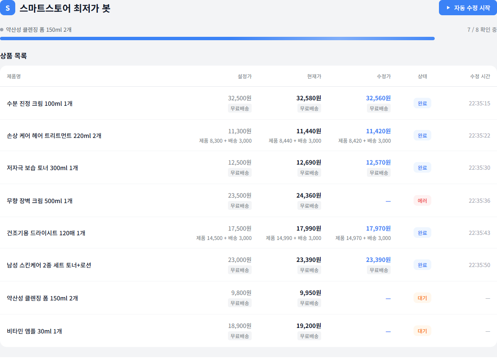

# 스마트스토어 최저가 자동 수정 프로그램 개선

1인 개발 · 작업 기간(2026년 7월 ~ 10월)

네이버 스마트스토어 판매가를 경쟁 판매처보다 낮게 자동으로 유지해주는 CLI 프로그램을 TypeScript 마이그레이션, Vitest 테스트 코드 추가, Electron GUI 전환으로 개선하는 프로젝트입니다.



## 기존 프로젝트(과거)

스마트스토어를 직접 운영하면서 매일 반복하던 가격 수정 작업을 자동화하기 위해 만든 CLI 프로그램입니다.

- **문제** — 경쟁 판매처 가격이 수시로 바뀌어, 제품마다 최저가를 확인하고 직접 수정하는 데 1개당 약 40초가 걸렸습니다.
- **해결** — Puppeteer로 판매처 가격을 수집하고, 목표가를 계산해 Commerce API로 자동 수정하는 CLI 프로그램을 만들었습니다.
- **성과** — 1개당 수정 시간을 약 15초로 줄였고, 3년 넘게 실제 운영에 사용하고 있습니다.

## 개선 프로젝트(현재)

직접 사용하면서 느낀 불편한 점과 코드 구조를 함께 개선하고 있습니다.

### 1. GUI 전환 중 기존 기능이 깨질 수 있다는 걱정

- **문제** — CLI 코드를 Electron GUI로 옮기는 과정에서 기존 기능이 그대로 동작할지 확신할 수 없었습니다.
- **해결** — TypeScript로 마이그레이션해 타입 안전성을 확보하고, Vitest로 기존 기능의 테스트 코드를 작성했습니다.
- **이유** — JSDoc은 타입을 주석으로 따로 적어야 해서, 언어 차원에서 타입을 한 번에 다룰 수 있는 TypeScript를 선택했습니다. 테스트 도구는 실행 속도가 빠른 Vitest를 선택했습니다.
- **성과** — 테스트 케이스 약 300개로 주요 로직을 검증하고, 정적 타입 검사로 에러를 미리 발견할 수 있게 됐습니다.

### 2. 매번 CLI로 실행해야 하는 불편함

- **문제** — 실행할 때마다 CMD 실행 → 프로젝트 폴더로 이동 → 명령어 입력을 거쳐야 했습니다.
- **해결** — Electron GUI로 전환해 버튼 클릭으로 실행할 수 있게 했습니다.
- **이유** — `.bat` 파일로도 실행 과정은 줄일 수 있지만, 실행 상황 표시처럼 이후 추가할 기능을 고려해 GUI를 선택했습니다.
- **성과** — 실행 과정을 3단계(CMD 실행 → 폴더 이동 → 명령어 입력)에서 2단계(프로그램 실행 → 시작 버튼 클릭)로 줄였습니다.

### 3. Node.js 보안 취약점이 앱에 영향을 줄 수 있다는 걱정

- **문제** — Node.js Brotli 압축 해제 취약점(CVE-2026-111497)으로 로컬 Node(v24.14.0)와 Electron 내장 Node(v24.21.0)가 모두 영향을 받았습니다.
- **해결** — 로컬 Node는 패치 버전(v24.22.1)으로 올렸습니다. Electron은 안정 버전에 아직 패치가 없어, 우회 코드를 넣기 전에 두 외부 API가 실제로 Brotli로 응답하는지 측정했습니다.
  - `Accept-Encoding`을 `gzip`/`br`로 바꿔 10회씩 호출한 결과, Google Sheets API는 무압축(297B) 또는 gzip(226B), Commerce API는 무압축(242,821B)으로만 응답했습니다.
  - 요청 헤더로 Brotli를 막는 방법은 googleapis가 헤더를 `gzip`으로 덮어써 효과가 없다는 것도 확인했습니다.
- **성과** — 두 API 모두 Brotli 응답이 없어, 코드 수정 없이 Electron 패치 버전이 나오면 업데이트하는 것으로 대응을 정리했습니다.

### 4. 실패해도 이유를 화면에서 알 수 없는 문제

- **문제** — 가격 수정에 실패하면 상태 칸에 "에러" 뱃지만 떠서 이유를 알 수 없었고, 순회 시작 전(시트 목록 조회, 네이버 로그인)에 실패하면 화면에 아무것도 표시되지 않았습니다.
- **해결** — 제품별 실패 이유는 상태 칸 뱃지 아래에, 순회 시작 전 실패 이유는 헤더 아래 배너로 표시했습니다.
  - 순회 시작 전 실패는 throw하지 않고 결과(`{ status: 'error', message }`)로 돌려줬습니다. IPC 핸들러에서 throw하면 Electron이 메시지 앞에 접두어를 붙여 보내기 때문입니다.
  - 접속 제한 에러는 중간 계층이 다른 에러로 감싸 던지므로, `cause`를 따라가 찾는 `findErrorInCause`로 구분해 순회를 멈추게 했습니다.
- **이유** — 화면에는 가장 바깥 에러의 메시지만 보내고 원인 에러는 로그로만 남겼습니다. 접속 제한만 원인 메시지를 보여준 건, 바깥 메시지로는 다시 시도하면 되는지 알 수 없기 때문입니다.
- **성과** — 콘솔 로그를 열지 않고도 화면에서 실패한 제품과 이유를 바로 확인할 수 있게 됐습니다.

## 아키텍처


## 기술 스택

| 영역            | 사용 기술                                    |
| --------------- | -------------------------------------------- |
| 언어            | TypeScript                                   |
| 실행 환경       | Node.js                                      |
| 데스크톱        | Electron, electron-vite                      |
| UI              | React 19, styled-components                  |
| 브라우저 자동화 | Puppeteer                                    |
| 외부 API        | 스마트스토어 Commerce API, Google Sheets API |
| 테스트          | Vitest, vitest-browser-react                 |
| 코드 품질       | ESLint, Prettier, Stylelint                  |

## AI 활용

Claude Code를 쓸 때 정한 원칙은 하나입니다. **결정은 제가 하고, AI는 선택지와 근거를 제시합니다.**

### 협업 규칙 정의 (`CLAUDE.md`)

세션마다 같은 설명을 반복하지 않도록, 지켜야 할 규칙을 `CLAUDE.md`에 적어 두었습니다.

- **선택지에 예시 코드 첨부**: 수정 방법이 여러 개면 선택지마다 예시 코드를 함께 받습니다.
- **테스트 동반**: 소스 파일을 바꾸면 같은 작업 안에서 테스트 파일도 함께 바꿉니다.
- **검증은 직접**: 테스트, 린트, 타입 검사는 제가 직접 실행해 결과를 확인합니다.

### 작업별 컨벤션 분리 (Skills)

모든 세션에 필요하지 않은 규칙은 스킬로 분리했습니다. 관련 작업을 할 때만 불러오므로 `CLAUDE.md`가 길어지지 않습니다.

| 스킬                    | 내용                                           |
| ----------------------- | ---------------------------------------------- |
| `git-commit-convention` | 커밋 단위(되돌릴 수 있는 단위), 메시지 형식    |
| `add-guideline`         | 새 지침을 넣을지, 어느 파일에 넣을지 판단 절차 |
| `write-skill`           | 스킬 파일 작성 방식(프론트매터, description)   |

### 활용 예시

#### 선택지 제안

수정 방법이 여러 개면 AI가 선택지를 예시 코드와 함께 제시하고, 제가 장단점을 비교해 고릅니다.

#### 테스트 코드 작성

소스 파일을 바꾸면 테스트도 같은 작업 안에서 함께 바꾸게 했습니다. 테스트 실행과 결과 확인은 제가 직접 합니다.

#### 리팩토링

동작은 그대로 두고 구조만 바꾸는 작업을 맡겼습니다. 기존 테스트가 통과하는지로 동작이 바뀌지 않았음을 확인합니다.

## 트러블슈팅

### 가격 수정 순회를 React에서 main으로 옮기기

**S — 상황**

가격 수정을 시작하면, React 훅(`useTargetProductsUpdate`)이 아래처럼 제품을 순회하며 단계마다 main에 요청을 보냈습니다. 처음에 이 구조를 택한 건 통신이 단순해서였습니다. 작은 기능을 하나씩 실행해 확인할 수 있었고, 요청마다 응답이 바로 돌아왔습니다.

```ts
// 변경 전: React 훅이 제품마다 main에 4번 요청
const useTargetProductsUpdate = () => {
  const start = async () => {
    for (const targetProduct of targetProducts) {
      const sellers = await window.api.getSellers(catalogURL, name);
      if (!sellers.isSuccess) break;

      // 내 스토어 이름이 main에만 있어 필터링도 main에 요청
      const filtered = await window.api.filterSellers(sellers.sellers, excluded);
      if (!filtered.isSuccess) break;

      const targetPrice = await window.api.getTargetPrice(prices, freeDeliveryPrice);
      if (!targetPrice.isSuccess) break;

      const result = await window.api.updatePrice(
        originProductNo,
        targetPrice.targetPrice,
        delivery,
      );
      if (!result.isSuccess) break;

      // ... 중간 과정 생략

      // 수정 결과를 화면 상태에 반영
      setUpdatedProducts(updatedTargetProducts);
    }
  };
};
```

하지만 기능을 추가하면서 이 구조로 계속 진행해도 괜찮은지 의문이 들었습니다.

- **훅의 책임을 벗어난 순회**: 훅의 책임은 화면에 보여줄 상태를 관리하는 것인데, 제품 수정 제어와 순회까지 맡으면서 범위를 벗어났습니다.
  - 훅이 약 120줄, 테스트가 약 470줄로 길어지고 이해하기 어려워졌습니다.
  - 무엇을 main에 요청할지 기준이 없어, 순수 함수인 수정가 계산(`getTargetPrice`)까지 형식적으로 main에 요청했습니다.
- **반복되는 통신 패턴**: 제품마다 main에 요청하고 `if (!x.isSuccess) break;`로 응답을 확인하는 패턴이 4번씩 반복됐습니다.

**T — 과제**

위 두 가지를 해결하기 위해 아래를 목표로 잡았습니다.

- **역할 분리**: 제품 수정 제어와 순회, 계산까지 모두 main이 맡고, 훅은 화면에 보여줄 상태만 관리하게 합니다.
- **통신 단순화**: 제품마다 4번씩 반복되던 요청과 응답 확인을 없애, React는 시작 요청과 상태 수신만 하게 합니다.

**A — 행동**

| 선택지                                                | 한계                                                               |
| ----------------------------------------------------- | ------------------------------------------------------------------ |
| A. React 순회 유지, 4개 채널을 1개로 합치기           | 순회와 제품 수정 제어가 여전히 React에 남아, 역할 분리가 되지 않음 |
| **B. 순회를 main으로 옮기고 상태 전체를 전송 (선택)** | 제품 1개만 수정돼도 목록 전체(약 150개)를 다시 보냄                |
| C. 순회를 main으로 옮기고 바뀐 상태만 전송            | 바뀐 상태 종류마다 React에 처리 분기가 늘어 복잡해짐               |

두 목표를 만족하면서 React 쪽 처리가 가장 단순한 B를 선택했습니다. 목록 전체를 보내는 부담은 제품마다 10초씩 대기하는 순회에 비하면 작다고 판단했습니다.

```ts
// 변경 후: React 훅은 시작 요청 1번, 이후 main이 보내는 상태를 받기만 함
const useTargetProductsUpdate = () => {
  // main이 보내는 메시지를 수신하는 이벤트를 등록해 상태 업데이트
  useEffect(() => window.api.onUpdateState((state) => setUpdateState(state)), []);

  // main에 가격 수정 시작 요청
  const startUpdate = () => window.api.startUpdate();
};
```

**R — 결과**

| 항목                         | 변경 전         | 변경 후                                      |
| ---------------------------- | --------------- | -------------------------------------------- |
| 훅 코드                      | 약 120줄        | 약 60줄                                      |
| 훅 테스트                    | 약 470줄 · 22개 | 약 160줄 · 8개                               |
| 제품 1개당 React → main 요청 | 4번             | 0번                                          |
| React에 노출한 통신 채널     | 6개             | 2개(가격 수정 요청, 메시지 수신 이벤트 등록) |

- 순회가 main 한 곳에 모여, 중복 실행 방지 같은 제어를 main에서만 처리하면 됩니다.

### 제품 가격비교 페이지 접속 차단 해결하기

**S — 상황**

어느 날 아침 확인해 보니, 프로그램이 가격비교 도메인(`search.shopping.naver.com`)에 접속할 때 접속 차단 페이지를 받고 있었습니다.

- **계정 차단**: 다른 브라우저나 모바일 데이터로 접속해도 마찬가지여서, 계정 자체가 차단된 상태였습니다.
- **예외 처리 부재**: 차단 페이지를 받고도 프로그램이 멈추지 않고 계속 돌았습니다.
- **쌓인 잘못된 요청**: 제품 하나에 페이지 3개를 거치고 150개를 반복하는 구조라, 자는 동안 약 13,000회의 잘못된 요청이 반복됐습니다. 서버가 이 패턴을 감지해 계정을 차단한 것으로 보입니다.

**T — 과제**

- **사고 재발 방지**: 차단 페이지를 받으면 즉시 멈춰, 잘못된 요청이 쌓이지 않게 합니다.
- **사이클 복구**: 제품 150개를 한 바퀴 도는 사이클이 차단 없이 다시 돌게 합니다.

**A — 행동**

먼저 차단 페이지를 감지하면 예외를 던지고, 이 예외만은 다음 제품으로 넘어가지 않고 순회를 멈추게 했습니다.

```ts
if (await isRestrictedPage(page)) {
  throw new UnexpectedCatalogPageError('네이버 쇼핑 접속이 일시적으로 제한되었습니다.');
}
```

다른 계정으로 로그인해 실행하니 다시 동작했습니다. 하지만 차단 페이지가 떴다는 건 서버가 무언가를 감지했다는 뜻이라, 같은 방식으로는 다시 차단될 수 있었습니다. 그래서 먼저 로그인한 상태에서 차단 조건을 찾았습니다.

| 시도                                         | 가설                               | 결과                                                     |
| -------------------------------------------- | ---------------------------------- | -------------------------------------------------------- |
| 9번째 제품마다 브라우저 재실행               | 브라우저 단위로 요청이 집계된다    | 15번째쯤 다시 막힘 → 브라우저가 아니라 IP 기준으로 추정  |
| 페이지 이동마다 2~3초, 재실행 시 30초 딜레이 | 짧은 간격으로 요청 한도를 소진한다 | 정상 동작. 대신 사이클이 20분에서 40분으로 늘어남        |
| puppeteer-extra stealth 플러그인             | 봇으로 탐지된다                    | 변화 없음. IP 기준이라면 브라우저 흔적을 지워도 소용없음 |

딜레이를 넣은 설정으로 2주쯤 돌았지만 두 번째 계정도 차단됐습니다. 계정을 계속 구하기는 어려워, 로그인 없이 돌릴 수 있는지 시도했습니다.

| 시도                               | 가설                                    | 결과                                                 |
| ---------------------------------- | --------------------------------------- | ---------------------------------------------------- |
| 로그인 과정만 제거                 | 로그인 없이도 접근할 수 있다            | 9번째 제품에서 로그인 페이지로 리다이렉트            |
| 조회 간격 테스트(11초, 30초, 60초) | 간격을 늘리면 한도 안에서 돌 수 있다    | 11초·30초는 8회차에서 막힘. 60초는 17회 통과         |
| 잘못된 URL 정리                    | 특정 제품에서만 보안 확인 페이지가 뜬다 | 시트의 오래된 URL이 원인. 최신 URL로 바꾸자 해결     |
| 리다이렉트되면 30분 대기 후 재개   | 한도가 시간이 지나면 회복된다           | 회복 후에도 다시 막히는 등 불규칙해 사이클 완주 불가 |

테스트 중에 두 응답의 원인이 서로 다르다는 것을 확인했습니다.

- **보안 확인 페이지**: 오래되거나 잘못된 파라미터가 있는 URL로 접속할 때
- **로그인 페이지 리다이렉트**: 요청 한도를 다 썼을 때

한도에 대한 일관된 규칙은 알 수 없어, 실제로 판매 중인 비슷한 프로그램의 설정(로그인 필수, 제품 간 10초 대기)을 기준점으로 삼았습니다.

최종적으로는 로그인을 유지하고, 요청 횟수 자체를 줄였습니다. 경로에서 페이지를 하나씩 빼며 테스트해 보니, 처음에 가격비교 홈을 한 번만 방문하면 이후에는 제품 가격비교 페이지로 바로 이동할 수 있었습니다. 제품 사이 간격은 참고한 프로그램에 맞춰 10초로 늘렸습니다.

**R — 결과**

| 항목                            | 차단 당시 | 개선 후                     |
| ------------------------------- | --------- | --------------------------- |
| 제품당 요청                     | 3회       | 1회(첫 실행 시 홈 1회 제외) |
| 제품 간 이동 간격               | 5초       | 10초                        |
| 제품 1개당 수정 시간(대기 포함) | 약 9초    | 약 15초                     |
| 차단 페이지 응답 시             | 계속 실행 | 즉시 종료                   |

- 한 사이클(제품 150개)을 약 40분에 돌며, 2개월 넘게 차단 없이 운영하고 있습니다.
- 보안 확인 페이지(잘못된 URL)와 로그인 리다이렉트(요청 한도)의 원인을 구분해, 요청 횟수를 줄이는 방향으로 해결했습니다.

### 에러 구조와 사용자 경험 개선하기

**S — 상황**

**사용자 경험의 문제**

- **원인을 알 수 없는 에러**: 화면에 "에러" 뱃지만 있고 메시지가 없어, 사용자가 가격 수정 실패 원인을 알 수 없었습니다.
- **잘못된 시트 행 처리**: 가격 칸이 잘못되면 그 제품을 조용히 건너뛰고, 배송 유형이 잘못되면 가격 수정 전체가 멈췄습니다. 어느 쪽이든 어떤 제품의 어느 칸이 문제인지 알 수 없었습니다.
- **아무것도 뜨지 않는 시작 전 실패**: 시트 목록 조회나 네이버 로그인에서 실패하면 화면에 아무것도 표시되지 않았습니다.

**에러 구조의 문제**

- **흩어진 메시지**: 에러 메시지 25곳이 17개 파일에 문자열로 직접 적혀 있었습니다.
- **중복된 메시지**: 같은 문구가 여러 곳에 있었습니다. 예를 들어 `'알 수 없는 배송비 유형입니다.'`는 3곳에 있었습니다.
- **중단할 에러를 구분하기 어려운 구조**: 접속 차단처럼 다음 상품도 실패할 에러는 순회를 멈춰야 합니다. 하지만 가장 바깥 에러가 `UnexpectedCatalogPageError`일 때만 구분할 수 있어서, 중간 계층이 이 에러만 감싸지 않고 다시 던져야 했습니다.
- **IPC를 거치면 사라지는 정보**: main의 에러가 renderer로 넘어가면 에러 클래스와 `cause`는 사라지고 메시지 문자열만 남았습니다.

**T — 과제**

- **사용자 경험**: 잘못 입력된 시트 칸, 가격 수정에 실패한 상품, 순회 시작 전 실패의 이유를 화면에서 바로 확인할 수 있게 합니다.
- **시트 행 처리**: 잘못된 행 하나가 가격 수정 전체를 멈추지 않게 하고, 정상인 상품은 계속 처리합니다.
- **에러 구조**: 메시지를 한곳에서 관리하고, 중간 계층이 에러를 감싸도 중단할 에러를 구분할 수 있게 하며, IPC를 거쳐도 화면에 보여줄 메시지가 남게 합니다.

**A — 행동**

**1. 에러 메시지를 한 파일에 모았습니다.**

메시지가 흩어져 있어 찾기 어렵고 중복이 생겨서, 사용자에게 보여줄 메시지를 `errorMessage.ts` 한 객체에 모았습니다. 원인이 된 값은 뒤에 괄호로 붙여, 어떤 값 때문에 실패했는지 알 수 있게 했습니다.

```ts
export const ERROR_MESSAGE = {
  UNKNOWN_DELIVERY_FEE_TYPE: '알 수 없는 배송비 유형입니다.',
  // ...
} as const;

throw new Error(`${ERROR_MESSAGE.UNKNOWN_DELIVERY_FEE_TYPE} (feeType: ${feeType})`);
```

**2. 실패해도 멈추지 않고 결과로 돌려줬습니다.**

행 하나의 에러가 전체를 멈추지 않도록, `parseProductRow`가 칸마다 `parseCell`로 변환해 실패한 칸의 이유를 모두 모아 결과로 반환하게 했습니다. 정상 행은 그대로 가격 수정에 쓰고, 실패한 행은 renderer로 보냅니다.

`try/catch`를 쓰면 들여쓰기가 늘어나 구조가 복잡해져서, `try/catch`를 감싼 `parseCell` 함수를 만들어 썼습니다.

```ts
// 칸 하나를 변환하고, 실패하면 이유를 errorMessages에 모은 뒤 undefined를 반환한다.
const parseCell = <T>(errorMessages: string[], columnKey: ColumnKey, parse: () => T) => {
  try {
    return parse();
  } catch (error) {
    errorMessages.push(`${columnKey}: ${error.message}`);
    return undefined;
  }
};

const feeType = parseCell(errorMessages, 'feeType', () =>
  validateFeeType(rowValues[COLUMN.feeType]),
);
```

가격 수정 순회에서도 같은 이유로, Promise의 결과를 `[에러, 값]`으로 돌려주는 `tryCatch` 함수를 만들어 썼습니다. 상품 하나가 실패해도 그 상품만 실패로 표시하고 다음 상품으로 넘어갑니다.

```ts
const [error, update] = await tryCatch(updateTargetProductPrice(page, targetProduct, myStoreName));
```

**3. 화면에 보낼 메시지의 기준을 정했습니다.**

IPC를 거치면 `message`만 남아서, 에러는 `ERROR_MESSAGE` 문구로 감싸 던지고 화면에는 가장 바깥 에러의 메시지만 보내게 했습니다. 자세한 원인은 `cause`에 담아 로그로 남깁니다.

```ts
throw new Error(ERROR_MESSAGE.SELLERS_FETCH_FAILED, { cause: error });
```

**4. 순회를 시작하기 전 실패는 throw하지 않고 결과로 돌려줬습니다.**

`ipcMain.handle`에서 throw하면 Electron이 메시지 앞에 접두어(`Error invoking remote method 'startUpdate': ...`)를 붙여서, 실패를 결과 객체로 돌려주게 했습니다.

```ts
type StartUpdateResult =
  { status: 'done' } | { status: 'running' } | { status: 'error'; message: string };
```

**5. 접속 제한 에러는 `cause`를 따라가 찾았습니다.**

중간 계층마다 접속 제한 에러만 예외로 다시 던지지 않도록, 모든 계층이 똑같이 감싸 던지고 `findErrorInCause`로 안쪽의 접속 제한 에러를 찾아 순회를 멈추게 했습니다. 바깥 메시지로는 다시 시도하면 되는지 알 수 없어서, 이때만 원인 메시지를 화면에 보냅니다.

```ts
const fatalError = findErrorInCause(error, UnexpectedCatalogPageError);
sendUpdate(index, { status: 'error', message: (fatalError ?? error).message });
if (fatalError) break;
```

**6. 실패 이유를 화면에 표시했습니다.**

"에러" 뱃지만으로는 원인을 알 수 없어서, 상품별 실패 이유는 상태 칸의 뱃지 아래에, 순회 시작 전 실패 이유(로그인 실패, 제품 정보 불러오기)는 Header 아래 배너로 표시했습니다.

**R — 결과**

| 항목                      | 변경 전                     | 변경 후                            |
| ------------------------- | --------------------------- | ---------------------------------- |
| 사용자용 에러 메시지 위치 | 17개 파일에 문자열로 흩어짐 | `errorMessage.ts` 한 파일(키 18개) |
| 문제 있는 시트 행         | 건너뛰거나 전체 중단        | 결과로 남기고 정상 행은 계속 처리  |
| 한 행의 잘못된 칸         | 첫 번째 하나만 확인 가능    | 모두 확인 가능                     |
| 상품별 실패 이유          | "에러" 뱃지만 표시          | 뱃지 아래에 이유 표시              |
| 순회 시작 전 실패         | 화면에 아무것도 없음        | Header 아래 배너로 표시            |
| 접속 제한 판별            | 중간 계층마다 예외 처리     | `findErrorInCause` 한 곳           |

- 콘솔 로그를 열지 않고도 화면에서 실패한 상품과 이유를 바로 확인할 수 있게 됐습니다.
